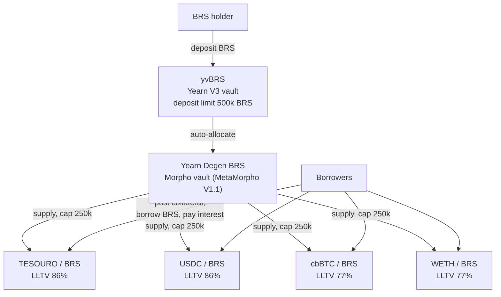
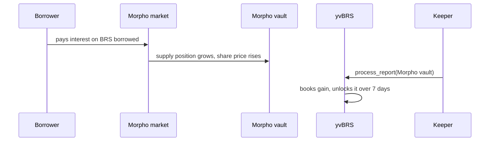
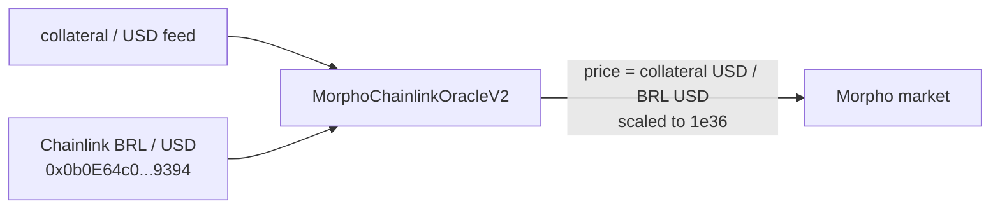
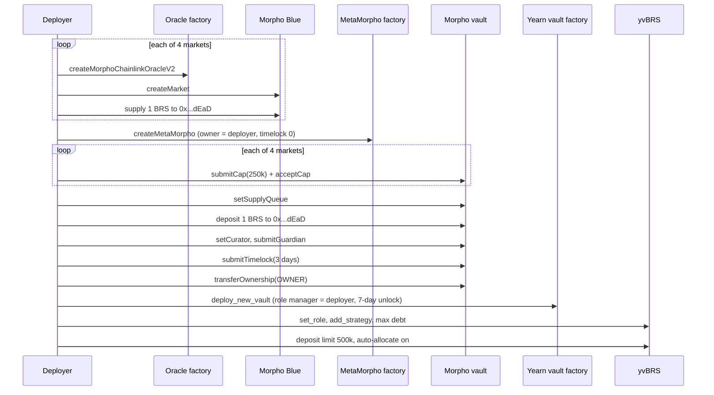

# BRS vaults on Base

Lending markets and vaults for **BRS**, the Brazilian real stablecoin issued by Nora Finance on Base
(`0x0000006238e3C7797Ae71827da303560bae1B125`, 6 decimals).

One Foundry script deploys the whole stack:

- four Morpho lending markets where users borrow BRS against TESOURO, USDC, cbBTC or WETH
- **Yearn Degen BRS** (`ymvDegen-BRS`), a Yearn-curated Morpho vault that lends BRS into those markets
- **yvBRS**, a Yearn V3 vault that deposits into the Morpho vault

The repo deploys no custom contracts. The script creates everything through Morpho and Yearn contracts already live
on Base.

## How it works

BRS holders deposit into yvBRS. yvBRS forwards every deposit to the Morpho vault, which spreads it across the four
markets. Borrowers post collateral, borrow BRS and pay interest. That interest raises the Morpho vault's share
price, and yvBRS books it as profit at each report.



Yield reaches depositors in four steps:



The interest rate follows Morpho's AdaptiveCurveIRM. It targets 90% utilization and drifts down while markets sit
below that, so lenders earn little until borrowers arrive.

## Markets

Every market lends BRS and uses the AdaptiveCurveIRM.

| Collateral | Token | Collateral / USD feed | LLTV | Vault cap |
|---|---|---|---|---|
| TESOURO (Etherfuse) | `0x7ceE47e7B7CD04CF984e8Dd86C42595B5771A9B2` | RedStone `0xb67047eDF6204F4C81333248dA71F8387050790C` | 86% | 250k BRS |
| USDC | `0x833589fCD6eDb6E08f4c7C32D4f71b54bdA02913` | Chainlink `0x7e860098F58bBFC8648a4311b374B1D669a2bc6B` | 86% | 250k BRS |
| cbBTC | `0xcbB7C0000aB88B473b1f5aFd9ef808440eed33Bf` | Chainlink `0x07DA0E54543a844a80ABE69c8A12F22B3aA59f9D` | 77% | 250k BRS |
| WETH | `0x4200000000000000000000000000000000000006` | Chainlink `0x71041dddad3595F9CEd3DcCFBe3D1F4b0a16Bb70` | 77% | 250k BRS |

TESOURO is Etherfuse's tokenized Brazilian treasury bond, earning about 12% a year in November 2026. Its holders
can loop: post TESOURO, borrow BRS, buy more TESOURO. Both sides are in reais, so the loop carries little FX risk.
These loopers are the natural borrowers, and they cap what lenders can earn: they borrow only while TESOURO yields
more than BRS costs.

cbBTC and WETH get a lower LLTV because BRS liquidity on DEXes is thin. The lower LLTV gives a larger liquidation
bonus, which pays liquidators to source BRS.

## Oracles

Each market uses a `MorphoChainlinkOracleV2` that prices collateral in BRS from two USD feeds:



The oracle treats 1 BRS as 1 BRL. No BRS market-price feed exists, so a BRS depeg would not move these prices.

## Deployment

`script/Deploy.s.sol` runs every step in one broadcast:



The vault starts with a zero timelock so the script can accept caps in the same transaction batch. It raises the
timelock to 3 days before it offers ownership to `OWNER`. Each market and the vault start with 1 BRS owned by a
burn address, so their share prices never start from an empty pool.

### Roles after deployment

| Contract | Role | Holder |
|---|---|---|
| Morpho vault | owner | deployer, until `OWNER` calls `acceptOwnership()` |
| Morpho vault | curator | `CURATOR` |
| Morpho vault | guardian | `GUARDIAN` |
| Morpho vault | timelock, fee | 3 days, 0% |
| yvBRS | role manager | deployer |
| yvBRS | add strategy, reporting, debt, max debt, deposit limit | deployer |

## Usage

```shell
git clone --recursive https://github.com/matheus1lva/brs-usdc-vault
cd brs-usdc-vault
forge build
forge test
```

The tests fork Base at the latest block. They read `BASE_RPC_URL` and fall back to `https://mainnet.base.org`.

To deploy, fund the deployer with 5 BRS (four market seeds and one vault seed) plus gas, then run:

```shell
OWNER=0x... CURATOR=0x... GUARDIAN=0x... \
forge script script/Deploy.s.sol --rpc-url $BASE_RPC_URL --account <keystore> --broadcast
```

Yearn's Base Morpho roles, read from the Yearn OG USDC vault (`0xef417a2512C5a41f69AE4e021648b69a7CdE5D03`), are
owner `0xFEaE2F855250c36A77b8C68dB07C4dD9711fE36F`, curator `0x90D0f26025571295D18a6c041E47450B81886B51` and
guardian `0xbfAABa9F56A39B814281D68d2Ad949e88D06b02E`. The tests use these addresses.

## Tests

`test/BrsFork.t.sol` runs the deploy script on a Base fork, then checks:

| Test | Proves |
|---|---|
| `test_vaultRoles` | pending owner, curator, guardian and the 3-day timelock are set |
| `test_oraclePrices` | each oracle matches the feed ratio within 1%; 1 USDC prices between 4 and 8 BRS |
| `test_lendBorrowReportWithdraw` | deposit 400k, rebalance, borrow in all four markets, 30 days of interest, report shows profit, repay, full exit returns more than deposited |
| `test_liquidation` | a healthy WETH position cannot be liquidated; after a 45% WETH price drop it can |

## After deployment

The script stops short of the Yearn handoff. These steps need Yearn sign-off:

1. `OWNER` accepts ownership of the Morpho vault and sets the fee.
2. yvBRS transfers its role manager to Yearn's Role Manager (`0xea3481244024E2321cc13AcAa80df1050f1fD456`).
3. Add yvBRS to the risk score registry and list both vaults on yearn.fi and the Morpho app.
4. Monitor the price feeds. The Morpho oracle has no staleness check.

## Risks

- **Issuer control.** Nora's 3/5 Safe can freeze any address, including Morpho Blue, claw back frozen balances and
  upgrade the BRS contract.
- **Thin liquidity.** On 2026-11-19 the main Aerodrome BRS/USDC pool held about 275k BRS and 8.4k USDC. Liquidators
  can source little BRS, which is why the caps are small.
- **Weekend FX.** BRL/USD trades only on weekdays. The feed goes flat over the weekend and can gap on Monday.
- **Single-source TESOURO price.** One RedStone feed prices TESOURO.
- **No yield without borrowers.** Lenders earn only what borrowers pay. BRS itself pays no yield.
- **Full exits.** Redeem `yvBRS.maxRedeem(owner)`, not the full share balance. The Morpho vault rounds withdrawals
  down by 1 wei, so redeeming the full balance can revert.

## Layout

```
script/Deploy.s.sol    deploys markets, Morpho vault and yvBRS
src/Addresses.sol      Base addresses
src/Interfaces.sol     minimal interfaces for the calls the script makes
test/BrsFork.t.sol     fork tests
```
